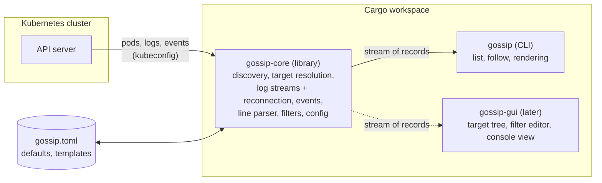

# Gossip — SPEC

Status: prototype built (PRs 1 to 8), hand checks against the cluster pending.

Gossip is a Rust command-line tool that follows the logs of a set of Kubernetes workloads, keeps following them across pod restarts and rollouts, merges the cluster's own events into the same stream, and understands JSON log lines. Prototype: one cluster at a time, a core library plus a CLI; a GUI comes later on the same core.

## 1. Goal and scope

Gossip replaces `kubectl logs -f` and stern for day-to-day work against a cluster, and goes further in three ways: it never loses the stream when a pod dies or a rollout replaces it, it shows the cluster's own events about those pods in the same stream, and it treats a JSON log line as data, not text.

In scope for the prototype:

- One cluster at a time, chosen from the contexts in the kubeconfig.
- Targets at any level: a namespace, a deployment, a pod or a container, several of them together, across namespaces.
- Discovery from the cluster: list contexts, namespaces, deployments and pods instead of typing names from memory.
- Live resolution: the set of followed pods updates itself when pods come and go.
- Log lines of all followed containers, merged into one ordered stream, with a prefix per source.
- Cluster events for the followed pods merged into the same stream, on by default, with a switch to turn them off.
- JSON log lines parsed into fields; plain lines kept as text.
- Simple filters on level, text and fields, expressed as rules that a config file can hold.
- A CLI with `list` and `follow`, plus a config file with saved selections (templates).
- A core library that holds all of the above, so a GUI can use it unchanged.

Out of scope for the prototype, kept open by the design:

- Following several clusters at once (the record carries the cluster name already).
- The GUI itself.
- Complex filter logic beyond and/or of simple rules.
- History, search, or storage of what was streamed.
- Anything that needs to run inside the cluster. Gossip is a client only.

## 2. Concepts

Five words carry the whole design. The core library is written in these terms and the CLI and the later GUI only present them.

| Concept | What it is | Example |
| --- | --- | --- |
| Cluster | One context of the kubeconfig. The prototype follows one at a time. | `aks-vulcan-01` |
| Target | What to follow: a namespace, narrowed optionally to a deployment, a pod or a container. Names may be globs. A session follows a set of targets. | `flowcpt/flowcpt-api`, `flowcpt/*`, `monitoring/prometheus/*/exporter` |
| Record | One item of the stream: a log line or a cluster event. Every record carries cluster, namespace, pod, container, timestamp, kind, and either the parsed fields of a JSON line, the raw text of a plain line, or the reason and message of an event. | a line from `flowcpt-api-7d9f-xk2p1` with `level=WARN`, `tenant_id=...` |
| Filter | A rule `field operator value`, or several joined with `and` / `or`. Applied to records before they are shown. | `level >= WARN and tenant_id == t_123` |
| Template | A named, saved combination of targets, filters and options in the config file. `gossip follow --template dev-api` runs it. | `dev-api`, `staging-all` |

A target is written as a path (the second level is any workload, Deployment to CronJob, see 4.3): `namespace[/workload[/pod[/container]]]`. A `*` matches any name at that level; `flowcpt/*` is every deployment of the namespace, `flowcpt` alone means the same. A pod given directly bypasses the deployment level: `flowcpt/-/flowcpt-api-7d9f-xk2p1`.

## 3. Architecture

One Cargo workspace with three crates. `gossip-core` holds everything that knows about Kubernetes, records, filters and config; `gossip` is the CLI; `gossip-gui` comes later and uses the core unchanged. The rule: nothing in a front end talks to the cluster, and the core prints nothing.



The cluster is reached through the API server only, with the user's kubeconfig; the core resolves targets into pods, opens a log stream per container and an event watch for the same pods, merges the two into one ordered stream of records, and applies the filters before handing the records to whichever front end is running.

| Crate | Kind | Holds |
| --- | --- | --- |
| `gossip-core` | library | kube client per context, discovery, target resolution, log streams with reconnection, event watcher, line parser, record type, filter engine, config and templates |
| `gossip` | binary | argument parsing (`clap`), the `list` and `follow` commands, terminal rendering with colours |
| `gossip-gui` | binary, later | the same session API, a tree of targets with checkboxes, a filter editor, and the console view |

## 4. The core library `gossip-core`

The core is an async library on `tokio` and `kube-rs`. Its public surface is small: open a cluster, list what is in it, start a session from targets, filters and options, and receive records from that session as a stream.

### 4.1 Cluster access

- `Cluster::contexts()` lists the contexts of the kubeconfig (`KUBECONFIG` or the default file), with the current one marked.
- `Cluster::open(context)` builds a `kube::Client` for that context. Credentials come from the kubeconfig as `kubectl` would use them, including exec plugins (the `az` login AKS uses).
- One cluster per session in the prototype. The record type still carries the cluster name.

### 4.2 Discovery

- `namespaces()`, `deployments(namespace)`, `pods(namespace, deployment?)`, each returning names with a little status (ready replicas, pod phase, restart count, age).
- Used by `gossip list` and, later, by the GUI's tree. No caching in the prototype.

### 4.3 Target resolution

- A target `namespace[/workload[/pod[/container]]]` with globs resolves to a set of (namespace, pod, container) triples.
- A bare namespace, or `namespace/*`, follows every pod in it, whatever owns them. Deployments are the common case, not the only one.
- The workload level takes the name of a Deployment, StatefulSet, DaemonSet, Job or CronJob. The name is looked up across those kinds; when two kinds share a name, a prefix picks one: `flowcpt/cronjob:nightly-sync`. A Deployment resolves through its ReplicaSets, a CronJob through its Jobs, the others through their `spec.selector`, to the pods carrying those labels.
- Resolution is live: the core runs a `kube_runtime::watcher` on pods in every namespace a target names, filtered by the labels when the target is a workload, and re-matches on every pod event. A new pod that matches gets a stream opened; a pod that is gone gets its stream closed. A CronJob's runs are picked up this way, each run a new pod with its lines and its `Completed` event.
- Besides the pods, the core watches what a workload target resolves through: the kinds its name is looked up in (the one object when the name is exact, the whole kind for a glob), ReplicaSets for deployments and Jobs for cron jobs. A label-filtered pod watch alone cannot see a workload that is created later, or the next run of a CronJob, whose pods carry labels of their own. A workload target therefore needs `list` and `watch` on those kinds; a bare namespace needs pods only. With events on (4.5), every namespace also watches its ReplicaSets and Jobs, to know which workload is above a pod.
- When a target matches nothing at start, the session says so in a record of kind `notice` and keeps watching; it does not fail.

### 4.4 Log streams and reconnection

- One `log_stream` per container, `follow: true`, `timestamps: true` (the kubelet's timestamp is what orders the merged stream, the application's own timestamp is kept as a field when the line has one).
- Start-up history: `--since` (duration) or `--tail` (lines) per container, default `--tail 20`.
- The stream ends when the container ends. The core reopens it when the pod shows a new container start (restart count went up, or a new pod replaced the old one), with `since` set to the time of the last line it saw, so nothing is lost and nothing is repeated.
- A dropped connection (API server hiccup, laptop sleep) is retried with exponential backoff, 1 s to 30 s, forever. Each retry writes a `notice` record.
- A connection can also die without a word: a NAT that forgets it, a laptop that slept. A log stream never writes, so silence is the only sign. A stream that has been silent for 90 s is opened again from the last line it saw. If it was alive this changes nothing and nothing is said; if lines had been held up, a `notice` says so.
- A container that is still `Waiting` (image pull, crash loop) has no stream; its state comes through as events (4.5) and as a `notice` when it changes.
- A container whose restart count is above zero at start, or that is `Waiting` in a crash loop, first gets the tail of its previous run (`previous: true`, same `--tail` / `--since`), its records marked `previous` and rendered dimmed, then the current run if there is one. That is the output of the run that crashed, which is what one starts Gossip for; without it one would wait through the back-off to watch it crash again.

### 4.5 Events

- A watcher on `Event` objects (`events.k8s.io/v1`) in every namespace a target names, kept to events whose `regarding` object is a followed pod, or the deployment or replica set above it.
- Each event becomes a record of kind `event` with `reason` (`Scheduled`, `Pulling`, `Started`, `Killing`, `BackOff`, `Unhealthy`, `Evicted`, ...), `message`, `type` (Normal or Warning) and a count.
- Kubernetes has no event for a container that exits. The core makes one from the pod status: when a followed container ends a run with an exit code other than zero, a record of kind `event` with reason `Exited`, type Warning and the exit code in its message.
- On by default; `--no-events` (CLI) or `events = false` (template) turns it off.

### 4.6 Line parser

- The format is detected per line, not per stream, because even a JSON service prints plain text now and then (a Rust panic, a sidecar, an init container). The recognisers run in this order and the first that accepts the line wins; the record notes which one in `format`.
- JSON: a line that starts with `{` and parses as a JSON object becomes a record with `fields`: a flat map of its top-level keys. Well-known keys are normalised into the record's own fields: `level` (`level`, `severity`, `lvl`), `message` (`message`, `msg`), `timestamp` (`timestamp`, `ts`, `time`), `target`. The rest stays in `fields` as it came, nested objects as JSON strings. The output of `tracing-subscriber`'s JSON formatter with `flatten_event(true)` is the first format it must handle.
- Span fields: that formatter puts the fields of the current span under a `span` object and the chain of spans the line was logged in under a `spans` list, from the outermost in, and these are the fields one filters on (`tenant_id`, `request_id`, `http.route`). The keys of `span` are merged into `fields`; a field of the line itself wins over a span field of the same name, and the level and the message are read from the line only, never from a span. `spans` is not kept as a field, but its spans are read in the same way first, because it repeats `span` only for a line logged in the outermost span: a line logged in a span inside the span of a request has the request's `tenant_id` in `spans` alone. An inner span wins over an outer one, and `span` over all of them. Nothing else is opened: any other nested object, also one inside a span, stays a JSON string. A `span` that is not an object, or a `spans` that is not a list, is not this formatter's and stays a field like any other. The record's `raw` is the line as it came.
- logfmt: a line made of `key=value` pairs, values quoted when they hold spaces (`time=2026-11-18T14:02:11Z level=info msg="request done" status=200`), becomes a record with the same `fields` and the same normalisation of the well-known keys. This is what most Go tooling in a cluster writes (ingress controllers, cert-manager, many operators). A line is logfmt only when every token is a pair; one bare word and it is text.
- Text: any other line is a record whose `format` is `text` (4.7), with the raw line as `message`. A level is guessed from a leading `ERROR`, `WARN`, `INFO`, `DEBUG`, `TRACE` token when present, also when a timestamp or a bracketed module comes first.
- Continuation: a line that starts with whitespace, or with `at ` or `Caused by:`, is appended to the previous record of the same container instead of becoming its own (a Rust panic's backtrace, a Java stack trace, a multi-line JSON pretty-print). The record's `message` grows by a newline and the line; its level and fields stay those of the first line. A continuation older than 2 s after the first line, or with no previous record, is text on its own.
- Panic block: the continuation rule has a second trigger. A line that starts with `thread '<name>' panicked at` opens a block (the first line of a Rust panic; toolchains since 1.91 put the id of the thread in brackets after the name, `thread 'main' (238) panicked at`). Every following line of the same container is appended to that record, as a continuation is, until a blank line, the next line that parses as JSON or logfmt, the next line that opens a block of its own, or the 2 s limit. The line that ends a block is a record of its own. So a panic arrives as one record with its message and its backtrace, although the message and `stack backtrace:` start at the margin.
- `format` option, per template or per container (`format = "auto" | "json" | "logfmt" | "text"`, default `auto`): forces one recogniser for streams where detection is wrong, such as a text line that happens to start with `{`. `text` also turns the continuation rule off, panic blocks included.
- Lines longer than 1 MiB are cut and marked.

### 4.7 Records

One type for everything the stream carries:

```rust
pub struct Record {
    pub cluster: String,
    pub namespace: String,
    pub pod: String,
    pub container: Option<String>,   // none for events on a deployment
    pub time: DateTime<Utc>,         // kubelet time for lines, event time for events
    pub kind: Kind,                  // Line, Event, Notice
    pub format: Format,              // Json, Logfmt, Text; Text for events and notices
    pub level: Option<Level>,        // Trace..Error; events map Warning to Warn
    pub message: String,
    pub fields: BTreeMap<String, Value>,
    pub raw: String,
    pub previous: bool,              // a line of the run before the current one (4.4)
    pub truncated: bool,             // the line was longer than 1 MiB and was cut (4.6)
}
```

In words: every record knows where it came from, when, what kind of thing it is, a level when one is known, a message, the structured fields when there are any, and the raw line for a `--raw` output. Two marks complete it: `previous` for a line of the run before the current one, and `truncated` for a line that was cut.

### 4.8 Filters

- A filter is a tree: a rule, or `and` / `or` / `not` over filters.
- A rule is `field operator value`. Fields: `level`, `message`, `pod`, `container`, `namespace`, `kind`, or any key of `fields` written `f.tenant_id`. Operators: `==`, `!=`, `>=` (levels only), `contains`, `matches` (regex), `exists`.
- A record with no level passes `level >=`, whatever the level asked for. Unknown is not the same as unimportant: a plain-text panic must not vanish under `--level warn`.
- Filters apply after parsing and before output. `notice` records always pass.
- The CLI exposes the common cases as flags (5); the full tree lives in the config file (6). Both build the same `Filter` value. The flags are about log lines: events always pass them (5.2). A filter in the config file is exactly what is written and applies to events too.

### 4.9 Session

- `Session::start(cluster, targets, filter, options) -> impl Stream<Item = Record>`.
- Options: `since`, `tail`, `events`, `containers` (a glob to keep sidecars out).
- The stream is ordered by `time` across sources with a small reorder buffer (default 250 ms); a record that arrives later than that is emitted late rather than dropped.
- Stopping the session closes every stream and watcher.

## 5. The CLI `gossip`

Two commands in the prototype, plus `templates` to see what the config file holds. `clap` with derive, `--help` on everything.

### 5.1 `gossip list`

| Form | Shows |
| --- | --- |
| `gossip list contexts` | the contexts of the kubeconfig, the current one marked |
| `gossip list namespaces` | the namespaces of the cluster |
| `gossip list flowcpt` | the deployments of the namespace, with ready / desired replicas and age |
| `gossip list flowcpt/flowcpt-api` | the pods of the deployment, with phase, restarts, age and containers |

`--context <name>` picks the cluster; without it the current context. `--json` prints the same as JSON for scripts.

### 5.2 `gossip follow`

`gossip follow <target>... [flags]` or `gossip follow --template <name> [flags]`. Flags given beside a template override its values, except the filter flags, which narrow its filter (see below the table).

| Flag | Meaning | Default |
| --- | --- | --- |
| `--context <name>` | cluster | current context |
| `--since <duration>` | history per container at start (`30s`, `5m`, `1h`) | none |
| `--tail <n>` | last n lines per container at start | 20 |
| `--no-events` | leave cluster events out | events on |
| `--container <glob>` | only containers matching | all |
| `--level <lvl>` | `level >= lvl` | all |
| `--grep <text>` | `message contains text` | none |
| `--match <regex>` | `message matches regex` | none |
| `--field <k=v>` | `f.k == v`, repeatable | none |
| `--no-filter` | drop the template's filter, so that only the filter flags apply | off |
| `--raw` | print the raw line, no parsing or colouring | off |
| `--output text\|json` | rendering (5.3) | text |
| `--no-color` | plain text | colour when stdout is a terminal |

The filter flags (`--level`, `--grep`, `--match`, `--field`) combine with `and`. More than that is a template.

- The filter flags apply to log lines. Events always pass them; `--no-events` is the switch for events.
- Beside a template the filter flags narrow, they do not replace: they are combined with the template's filter by `and`, so a line must pass both.
- `--no-filter` drops the template's filter first, for the case where one wants to replace it. The same holds for a filter under `[defaults]`.

### 5.3 Output

Text output, one line per record:

```
14:02:11.482 flowcpt-api-7d9f-xk2p1 api  WARN  tenant_id=t_123 request_id=8b1c  payment intent expired
14:02:11.490 flowcpt-api-7d9f-xk2p1 💀         Killing: Container api failed liveness probe, will be restarted
14:02:13.004 flowcpt-api-7d9f-xk2p1 🚀         Started: Started container api
14:02:13.210 flowcpt-api-7d9f-xk2p1 api  INFO  environment=staging version=0.14.2  starting
```

A request line of a service that logs with `tracing` (4.6), with no flags:

```
14:00:01.000 fc-api-0 api  INFO  http.method=GET http.route=/api/v1/sources http.status_code=200 tenant_id=3K6ehNLhnRsPfWhzjugmea user_id=auth0|6a86204723ca712d0c11f85a request_id=32e49c93-4c57-43a0-9439-c554e5fff1f6 time.busy=5.53ms  close
```

- Time in the local zone, pod and container as a prefix in a colour per pod (stable for the life of the pod), the level coloured, then the fields of a JSON line that are not the message, then the message.
- Events carry an emoji in place of the container column, one per reason, so the eye reads the pod's life without reading words: 📍 `Scheduled`, 📦 `Pulling` and `Pulled`, 🚀 `Started`, 💀 `Killing` and a container exit with a non-zero code, 🔥 `BackOff` (crash loop and image pull back-off), ⚠️ `Unhealthy` and other Warning events, 🧹 `Evicted` and `Preempted`, ℹ️ any other reason. Normal events are dimmed; Warning events take the warning colour.
- `--no-emoji` replaces the emoji with the four-letter tag `EVNT` in the same column. The fallback is automatic when stdout is not a terminal or the locale is not UTF-8. Emoji are two cells wide in most terminals; the prefix column is measured with that in mind so the lines stay aligned.
- Notices from the core (reconnecting, target matches nothing, a pod went away) in the quiet colour with a `--` prefix.
- The fields of a line, without `--fields`: first the well-known ones in this fixed order, each only when the line has it: `http.method`, `http.route`, `http.status_code`, `tenant_id`, `user_id`, `request_id`, `time.busy`. Then every other field in alphabetical order.
- Hidden by default: `timestamp` and `target`, because the time is on the record already and where in the code a line was logged is rarely what one reads for; and `otel.name`, `otel.kind`, `otel.status_code`, `http.target`, `http.scheme`, `http.flavor`, `http.host`, `http.user_agent`, `http.client_ip`, `time.idle`, `name` and `spans`, because they repeat the route or the status, or are noise on every line.
- `--fields <a,b,c>` replaces all of this with the fields named, in that order, a hidden one like any other. `--fields all` shows every field, the hidden ones too, in the default order.
- The well-known and the hidden names are one table in the CLI crate, the only place to change them. All of this is a matter of the text output: the record and the JSON output keep every field.
- Pod names are shortened to the replica-set hash and pod suffix (`7d9f-xk2p1`) when every followed pod belongs to a deployment; `--long-names` keeps them whole.

JSON output (`--output json`): one record per line as JSON, every field of 4.7, for `jq` and for the GUI later.

### 5.4 Exit and signals

- `Ctrl-C` stops the session and exits 0.
- A cluster that cannot be reached at start exits 1 with the error; once following, the core retries instead.

## 6. Config file and templates

One TOML file, `~/.config/gossip/gossip.toml` (`$GOSSIP_CONFIG` overrides the path). It is the one place the CLI and the later GUI share, and the GUI's filter editor is an editor of this file. The core reads and writes it; the CLI only reads it in the prototype.

```toml
[defaults]
context = "aks-vulcan-01"
tail = 20
events = true

[templates.dev-api]
context = "aks-vulcan-01"
targets = ["flowcpt/flowcpt-api", "flowcpt/flowcpt-web-api"]
container = "api"
filter = { all = [
  { field = "level", op = ">=", value = "info" },
  { any = [
    { field = "f.tenant_id", op = "==", value = "t_123" },
    { field = "kind", op = "==", value = "event" },
  ] },
] }
fields = ["tenant_id", "request_id"]

[templates.staging-all]
context = "aks-vulcan-01"
targets = ["flowcpt-stg/*"]
since = "5m"
```

- `[defaults]` fills in anything a template or the command line leaves out.
- A template holds everything `follow` takes: `context`, `targets`, `container`, `since`, `tail`, `events`, `format`, `filter`, `fields`, `output`. `format` may also be given per container as a table, `format = { api = "json", envoy = "text" }`.
- `fields` is the list of fields shown, in that order, the same as `--fields`; `fields = []` means the message only. A template that leaves it out gets the default of 5.3.
- A filter is either a rule (`field`, `op`, `value`) or one of `all`, `any`, `not` over filters, nested as deep as needed. This is the same `Filter` value the flags build, so a template can be as simple as one rule or as complex as the GUI will later make it.
- `gossip templates` lists the templates with their targets; `gossip templates show <name>` prints one.
- Unknown keys are an error with the line number, so a typo in a template does not silently follow the wrong thing.
- Nothing secret goes in this file. Credentials stay in the kubeconfig.

## 7. Acceptance

1. `gossip list contexts`, `gossip list namespaces`, `gossip list <ns>` and `gossip list <ns>/<deployment>` print what `kubectl` shows for the same cluster.
2. `gossip follow flowcpt/flowcpt-api` prints the last 20 lines of every container of every pod of the deployment, then new lines as they arrive, each with a coloured pod prefix.
3. Kill a pod of the deployment while following: the `Killing` and `Started` events appear in the stream, the new pod's lines follow without any action, and no line of the old pod is printed twice.
4. Roll out a new image while following: the new pods are picked up as they come, the old ones go away, with a notice for each.
5. Scale a deployment from 0 while following a target that matched nothing: a notice says so at start, and the lines appear when the pod comes up.
6. Put the laptop to sleep for a minute while following: the stream resumes by itself with a reconnect notice and the lines missed in between (within the kubelet's retention).
7. A JSON line from `tracing-subscriber`'s JSON formatter is rendered as level, fields and message; `--field tenant_id=t_123` keeps only that tenant's lines; `--level warn` hides info lines; lines with no level and events still show.
8. A logfmt line from an ingress controller is rendered as level, fields and message like a JSON line; a Rust panic with its backtrace arrives as one record whose message holds every line; `format = "text"` on a container shows its lines untouched.
9. `--no-events` shows no event records; `--raw` prints lines byte for byte.
10. `gossip follow --template dev-api` behaves as the flags spelt out in the template; a flag beside it overrides, a filter flag narrows the template's filter, and `--no-filter` drops that filter first.
11. `--output json` lines parse with `jq` and carry every field of the record.
12. Following a namespace with 20 pods for an hour does not grow memory beyond the reorder buffer and the line buffers; CPU is idle between lines.
13. `cargo test`, `cargo clippy --workspace -- -D warnings` and `cargo fmt --check` are clean. The core's tests cover target parsing and globs, the line parser on JSON, logfmt and plain lines and the continuation rule, filter evaluation, and the reorder buffer; the resolver and the streams are tested by hand against the dev cluster for the prototype, with no integration tests against a cluster in CI yet.

## 8. Notes for the implementer

- Crates: `kube` with features `client`, `runtime`, `rustls-tls`, plus `ring` (rustls needs a crypto backend, and `kube` makes one pick it) and `http-proxy` and `socks5` (without them `kube` refuses to build a client as soon as `HTTPS_PROXY` is set or the kubeconfig has a `proxy-url`, where `kubectl` just uses the proxy), and `k8s-openapi` with the feature of the newest Kubernetes version the crate offers at the time of writing (it picks the API type definitions compiled in, not which clusters can be reached; everything Gossip uses has been stable for years); `tokio`, `futures`, `serde` / `serde_json`, `toml`, `clap` (derive), `chrono`, `globset`, `regex`, `owo-colors` or `anstyle` for colour, `anyhow` and `thiserror`. Check versions at the time of writing; do not pin from memory. Rust edition 2024, latest stable toolchain.
- `kube::Config::infer()` reads `KUBECONFIG` and the current context; `Config::from_kubeconfig` with `KubeConfigOptions { context: Some(name), .. }` picks another one. AKS contexts use an exec plugin (`kubelogin`), which `kube` runs by itself.
- `Api::<Pod>::namespaced(client, ns).log_stream(name, &LogParams { follow: true, timestamps: true, container: Some(c), since_seconds / tail_lines, .. })` gives an `AsyncBufRead`; split it on newlines with `tokio::io::AsyncBufReadExt::lines`. The kubelet puts an RFC 3339 timestamp and a space in front of every line when `timestamps` is set.
- Use `kube_runtime::watcher` with `watcher::Config::default().labels(selector)` for pods and `WatchStreamExt::default_backoff()` for the retries on the watch itself; the log streams need their own retry loop since they are plain HTTP responses.
- Events: the `Event` type of `k8s_openapi::api::events::v1`; filter by `regarding.uid` against the followed pods' uids, and by `regarding.kind` in `Deployment` / `ReplicaSet` for the ones above them. `event_time` or `series.last_observed_time`, falling back to `deprecated_last_timestamp`, is the time to merge on.
- The merge: `futures::stream::select_all` over the per-container streams and the event stream, then a small `BinaryHeap` keyed by time with a 250 ms hold, in one task that owns every stream; add and remove streams through a channel from the resolver.
- Expect clock skew between nodes of a few milliseconds and the odd line that arrives seconds late after a reconnect; the buffer emits late records late, it never drops them.
- The resolver must handle a deployment whose selector matches pods of another, older replica set during a rollout: both sets are followed, that is correct.
- Keep the core free of `println!` and of terminal colour; rendering is the CLI's. Everything the core wants to tell the user is a `Notice` record.
- Namespace the config under `directories::ProjectDirs::from("", "", "gossip")` so the path is right on Linux, macOS and Windows.

## 9. Project

- Public, open source under Apache-2.0, in the GitHub organisation Open-Breach, like Rick.
- Distribution and packaging are not decided for the prototype; `cargo install --path .` is enough for now.
- Open for later, by design: following several clusters at once, the GUI, integration tests on a kind cluster in CI.
